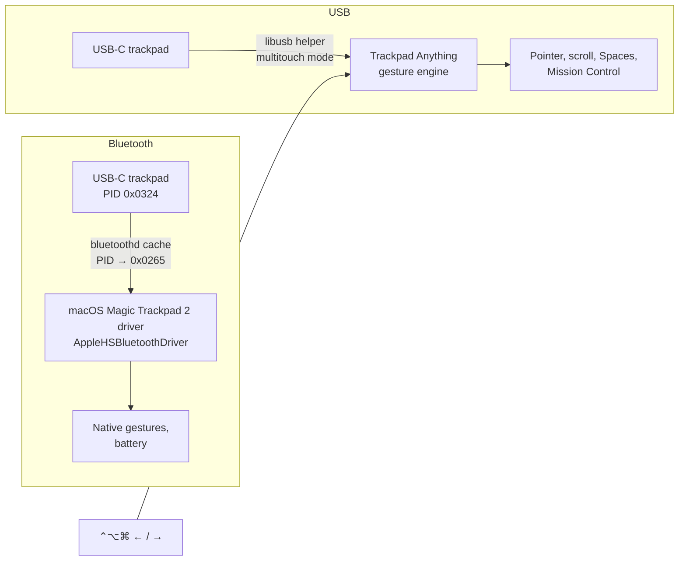

<div align="center">

<h1> Trackpad Anything</h1>

### Make the USB‑C Magic Trackpad work on macOS Sonoma

Full multi‑touch gestures over **Bluetooth** and **USB** — without upgrading to macOS 15.

[](#requirements)
[](#requirements)
[](https://github.com/souluk319/Trackpad-Anything/releases/latest)
[](LICENSE)
[](#is-it-safe)

[**Download**](https://github.com/souluk319/Trackpad-Anything/releases/latest) · [How it works](#how-it-works) · [FAQ](#faq)

**English** · [한국어](README.ko.md) · [日本語](README.ja.md) · [简体中文](README.zh-CN.md)


</div>

---

## The story

I spend a lot of my day remote‑controlling other computers with Parsec and Jump Desktop. The thing that makes that bearable is a trackpad: four fingers, swipe, and I'm on a different screen. So I bought Apple's new **Magic Trackpad (USB‑C)**.

It didn't work. The USB‑C model officially needs **macOS 15.1**, and on my Mac it showed up as a plain mouse: no scrolling, no swipes, no Mission Control.

The obvious fix is "just update macOS." I can't. I make music, and my audio plugins aren't ready for Sequoia, so this Mac stays on **macOS 14 Sonoma**. Returning a perfectly good trackpad because of a version number felt wrong, so I took it apart in software instead.

First came a USB driver for the cable. Bluetooth was harder: Sonoma throws the trackpad's touch data away before any app can see it. After a lot of dead ends (raw HID reports, L2CAP channels, DriverKit, cache tricks), the answer was smaller than expected. Over Bluetooth, the USB‑C trackpad is really a Magic Trackpad 2 under a new name, and Sonoma already knows how to drive one.

**Trackpad Anything** is the result. It brings the USB‑C trackpad to life on Sonoma, without a kernel extension, without turning off SIP, and without a paid developer account. If you're stuck on an older macOS for your own reasons, it's for you too.

<div align="center">

</div>

## Features

| | |
|---|---|
| 🛜 **Bluetooth, natively** | One click lets macOS's own Magic Trackpad 2 driver run the USB‑C model. Gestures come from macOS itself, so they feel exactly like the real thing. |
| 🔌 **USB, too** | A built‑in gesture engine reads the trackpad directly over the cable: pointer, two‑finger scroll, pinch, Spaces, Mission Control, App Exposé and more. |
| ⌨️ **Keyboard shortcuts** | **⌃⌥⌘←** / **⌃⌥⌘→** switch desktops on *this* Mac with the real swipe animation, even inside a full‑screen remote desktop. Built in, no Karabiner needed. |
| 🖥 **Remote‑desktop friendly** | Four‑finger swipes and shortcuts move *local* Spaces even while a remote desktop app is full screen. Works with Parsec, Jump Desktop and other remote desktop apps. |
| 🔋 **Battery in the menu bar** | The mascot plus a battery with the percentage inside. It follows light and dark menu bars. |
| 🎛 **One app for both** | Pointer, scroll and gesture settings in one place. The optional **settings mirror** applies them to macOS's trackpad preferences while you're on Bluetooth. |
| 🌐 **Four languages** | English, 한국어, 日本語, 简体中文. Follows your system language, or pick one in the sidebar. |
| ↩️ **Reversible** | Backups are made automatically. **Restore** puts everything back. |

<table>
<tr>
<td></td>
<td></td>
</tr>
</table>

## Requirements

- macOS **14 Sonoma**, tested on 14.7.2
- **Apple Silicon** Mac. Intel builds are not provided yet.
- Magic Trackpad (USB‑C), USB product ID `0x0324`
- What has been tested, and how to undo or recover: [Testing and recovery](docs/TESTING.md) · [Third‑party notices](docs/THIRD-PARTY.md)

> On macOS 15.1 or later you don't need this app. Apple supports the trackpad there.

## Install

1. Download `Trackpad-Anything-x.y.z-macOS-AppleSilicon.zip` from [**Releases**](https://github.com/souluk319/Trackpad-Anything/releases/latest) and unzip it.
2. Move **Trackpad Anything.app** to **Applications**.
3. **First launch:** the app isn't notarized, so macOS will warn you the first time.
   Right‑click the app → **Open** → **Open**. Or go to System Settings → Privacy & Security → **Open Anyway**.
4. Allow **Accessibility** when asked. It's needed for the USB gesture engine and keyboard shortcuts. Bluetooth gestures work without it.

<details>
<summary>Prefer the terminal?</summary>

```sh
xattr -dr com.apple.quarantine "/Applications/Trackpad Anything.app"
```
</details>

## Usage

### Bluetooth (recommended)

1. Pair the trackpad over Bluetooth as usual.
2. Open Trackpad Anything → **Bluetooth** in the sidebar.
3. Click **Enable Bluetooth Gestures** and enter your administrator password.
4. Bluetooth reconnects for a few seconds. The trackpad then runs on macOS's own driver.

That's it. It keeps working after reboots, even when the app is closed.
To undo it, click **Restore**.

> **Charging tip:** plugging the trackpad into *this Mac* with a cable re‑pairs it, and that resets the change. Charge from a wall adapter, or click *Enable* again afterwards.

### USB

Plug in the cable and keep the app running in the menu bar. The first time, it asks for your administrator password once to attach its USB helper. Settings live under **Pointer & Scroll**, **Gestures** and **Spaces**.

### Keyboard shortcuts

| Shortcut | Action |
|---|---|
| **⌃ Control + ⌥ Option + ⌘ Command + ←** | Previous desktop / full‑screen app |
| **⌃ Control + ⌥ Option + ⌘ Command + →** | Next desktop / full‑screen app |

These switch Spaces on the Mac in front of you, with the same animation as a four‑finger swipe. Turn them on or off under **Shortcuts**. They need Accessibility permission.

<details>
<summary>Scripting or Karabiner users</summary>

The app also ships a tiny CLI you can call from anywhere:

```sh
"/Applications/Trackpad Anything.app/Contents/Resources/space-command" left   # or: right
```
</details>

## How it works



**Bluetooth.** Over Bluetooth, the USB‑C trackpad speaks the same protocol as the Lightning Magic Trackpad 2, and Sonoma already ships a driver for that one. The only thing in the way is the product ID. Trackpad Anything changes the trackpad's product ID **in the Mac's Bluetooth device cache** from `0x0324` to `0x0265`, then restarts `bluetoothd`. macOS picks the built‑in driver as if it were the Lightning model.

- **Changed:** two product‑ID fields of that one trackpad's record (`HIDProductID` and the Device ID record in `SdpCache`).
- **Never touched:** firmware, system files, SIP, pairing keys, other devices.
- If the cache format isn't exactly what's expected, the tool stops without writing anything.
- A root‑only backup is kept next to the cache (`…devices.plist.tc-before-pid-spoof`).

**USB.** A small root helper (`usb-helper`, libusb) borrows the trackpad's multitouch interface while the app runs. It switches the trackpad to multitouch mode and streams raw frames to the gesture engine, which posts standard macOS events. When the app quits, the helper hands the interface back to macOS.

**Shortcuts.** The app watches for ⌃⌥⌘←/→, consumes them so a remote app doesn't also receive them, and asks the gesture engine for a native Dock swipe. That's why the switch happens on your Mac, not on the remote one.

Getting here took some digging. On Sonoma, the raw Bluetooth touch reports (`0x31`) are dropped before they reach user space, and the L2CAP channels belong to `bluetoothd`. The full write‑up is in [docs/BLUETOOTH-INVESTIGATION.ko.md](docs/BLUETOOTH-INVESTIGATION.ko.md) (Korean).

## Is it safe?

- **No kext, no SIP changes, no system files modified.** On Bluetooth, the driver doing the work is Apple's own.
- Admin rights are used only for the two small helpers. Both are inside the app bundle and readable in this repo.
- Everything is reversible: **Restore** in the app, or re‑pair the trackpad.
- The settings mirror is **off by default**. macOS trackpad preferences are shared by every trackpad, including a MacBook's built‑in one, so the app warns you before writing them and backs up the previous values.

## Status

| Feature | Bluetooth | USB |
|---|:-:|:-:|
| Recognized as a trackpad by macOS | ✅ | — |
| Pointer, two‑finger scroll | ✅ | ✅ |
| Spaces swipe, Mission Control | 🍎 | ✅ |
| ⌃⌥⌘←/→ desktop shortcuts | ✅ | ✅ |
| Battery in the menu bar | ✅ | ✅ |
| Pinch, App Exposé, Launchpad, Show Desktop | 🍎 | 🧪 |
| Force Click, haptics | 🍎 🧪 | ❌ |

✅ verified on hardware · 🍎 handled by Apple's own driver, which also loads its haptics (Actuator) interface · 🧪 implemented, needs more testing · ❌ not available

Tested on an M1 Pro MacBook Pro running macOS 14.7.2. Reports from other Macs are very welcome. Please [open an issue](https://github.com/souluk319/Trackpad-Anything/issues).

## FAQ

<details><summary><b>Why not just upgrade to macOS 15?</b></summary>
If you can, do. Some setups can't: audio plugins, managed machines, older software. This project is for them.
</details>

<details><summary><b>Does it survive reboots and macOS updates?</b></summary>
Reboots: yes. Minor macOS updates may rewrite the Bluetooth cache. If gestures stop, open the app and click <i>Enable</i> again. If an update changes the cache format, the tool refuses to write and tells you.
</details>

<details><summary><b>Intel Macs?</b></summary>
Not yet. The release is Apple Silicon only, because the bundled libusb is arm64. Building from source on Intel should work. A universal build is planned.
</details>

<details><summary><b>Why does the app ask for my administrator password?</b></summary>
To edit the Bluetooth cache, which is root‑only, and to start the USB helper. Nothing else runs with elevated rights.
</details>

<details><summary><b>Do the shortcuts work with a regular keyboard and mouse?</b></summary>
Yes. They don't depend on the trackpad at all, so they're handy for any remote‑desktop setup.
</details>

<details><summary><b>System Information still shows product ID 0x0324.</b></summary>
That's expected. It's a display field and doesn't affect which driver is used.
</details>

## Build from source

```sh
# Requirements: Xcode Command Line Tools, Homebrew libusb + pkg-config, Node.js 20+
brew install libusb pkg-config
git clone https://github.com/souluk319/Trackpad-Anything.git
cd Trackpad-Anything/GUI && npm ci && cd ..

TC_SIGN=adhoc bash scripts/build-gui.sh   # → build/Trackpad Anything.app
bash scripts/test.sh                      # gesture engine + settings tests
bash scripts/package-release.sh           # → build/release/*.zip
```

For day‑to‑day development, `python3 scripts/setup-local-signing.py` creates a stable local signing identity, so macOS keeps the Accessibility permission across rebuilds. See [docs/LOCAL-SIGNING.ko.md](docs/LOCAL-SIGNING.ko.md).

Translations live in [`scripts/locales.py`](scripts/locales.py). It generates `GUI/src/locales.json` and fails if a string used in the code has no translation.

<details>
<summary>Project layout</summary>

```
Sources/App            Native host (menu bar, shortcuts, WebKit UI bridge, settings mirror, i18n)
Sources/Core           Gesture engine (USB frames → macOS events)
Sources/USBHelper      Root USB helper (libusb)
Sources/BluetoothSetup bt-spoof: Bluetooth cache product-ID tool
Sources/Command        space-command CLI
GUI/                   Settings UI (React + Astryx)
scripts/               Build, release, signing, brand assets, translations
tests/                 Engine and settings tests
```
</details>

## Credits

- **Bluetooth product‑ID approach:** idea from [GianMarioBen/MagicTrackPadCatalina](https://github.com/GianMarioBen/MagicTrackPadCatalina/pull/1) (macOS Catalina). Trackpad Anything is an independent implementation for the Sonoma cache format.
- **Protocol references:** Linux [`hid-magicmouse`](https://github.com/torvalds/linux/blob/master/drivers/hid/hid-magicmouse.c), [MagicTrackpad2ForWindows](https://github.com/vitoplantamura/MagicTrackpad2ForWindows), [mr-cal/Linux-Magic-Trackpad-2-USB-C-Driver](https://github.com/mr-cal/Linux-Magic-Trackpad-2-USB-C-Driver).
- **Dock notifications:** based on [LinearMouse DockKit](https://github.com/linearmouse/linearmouse) (MIT).
- **UI:** [Astryx](https://www.npmjs.com/package/@astryxdesign/core) (MIT), [Heroicons](https://heroicons.com) (MIT). **USB:** [libusb](https://libusb.info) (LGPL‑2.1, statically linked).

## License

[GPL‑3.0](LICENSE) © 2026 **KUGNUS LAB**

Not affiliated with or endorsed by Apple Inc. Magic Trackpad, macOS and Mac are trademarks of Apple Inc.
